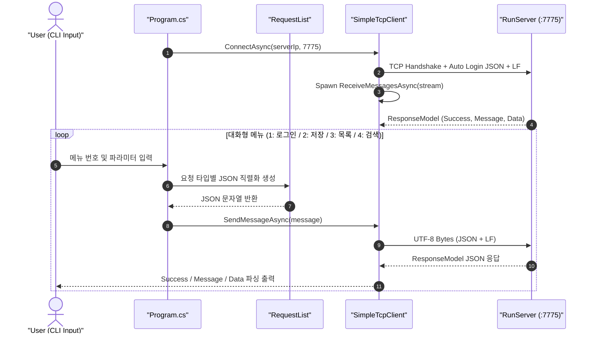

# SClient

> **`RunServer` (v2) 연동을 위한 .NET 8 대화형 비동기 TCP 소켓 CLI 클라이언트**


`SClient`는 비동기 TCP 소켓 서버인 [`RunServer`](https://github.com/tejo1990/RunServer)(`:7775`)에 접속하여 **자동 로그인 핸드셰이크, 사용자 학습/콘텐츠 데이터 저장(Upsert), 현재 접속 중인 클라이언트 목록 조회, 사용자 ID 검색**을 터미널 메뉴에서 즉시 수행하고 검증할 수 있는 **.NET 8 콘솔 클라이언트**입니다.

---

## 1. Why (제작 목적 및 배경)

[`RunServer`](https://github.com/tejo1990/RunServer)가 비동기 멀티 클라이언트 구조와 개행(`\n`) 구분 기반 JSON 프로토콜로 업그레이드됨에 따라, 실제 단말(콘텐츠 앱)에 소켓 모듈을 탑재하기 전 다음 항목을 독립적으로 검증할 표준 레퍼런스 클라이언트가 필요했습니다.

- **전송/수신 루프 비동기 분리**: 메인 스레드에서 사용자 콘솔 입력을 받아 요청을 송신(`SendMessageAsync`)하는 동시에, 백그라운드 태스크(`ReceiveMessagesAsync`)에서 서버 응답을 논블로킹으로 수신·파싱합니다.
- **프로토콜 빌더 표준화**: `RequestList` 정적 팩토리를 통해 `login`, `save`, `List`, `Search` 페이로드를 일관된 JSON 스키마로 직렬화하고 `\n` 프레임 종료자를 자동 부착합니다.

### 연관 소켓/서버 생태계 (Related Repositories)

| 레포지토리 | 역할 및 버전 | 기술 스택 | 프로토콜 프레이밍 |
| :--- | :--- | :--- | :--- |
| **[`SClient`](https://github.com/tejo1990/SClient)** *(현재 레포)* | **`RunServer` 전용 대화형 비동기 CLI 클라이언트** | C# / .NET 8.0 | JSON + `\n` (Port `7775`) |
| [`RunServer`](https://github.com/tejo1990/RunServer) | v2 비동기 멀티 클라이언트 TCP & MySQL 세션 서버 | C# / .NET 8.0 / MySQL | JSON + `\n` (Port `7775`) |
| [`SocketClient`](https://github.com/tejo1990/SocketClient) | 경량 원시 문자열/JSON 송수신 진단 스크립트 | Python 3 (`socket`, `json`) | Raw / JSON (Port `7775`) |
| [`servermanager`](https://github.com/tejo1990/servermanager) | 2초 주기 TCP 서버 상태 감시(Watchdog) 데몬 | C# / .NET 8.0 | JSON + `<EOP>` (Port `7775`) |
| [`RunServer_DB_socketAPI`](https://github.com/tejo1990/RunServer_DB_socketAPI) | v1 동기식 TCP-MySQL 브리지 프로토타입 서버 | C# / .NET Framework 4.8 | JSON / `<EOP>` (Port `7775`) |

---

## 2. What (핵심 기능 및 대화형 명령 명세)

프로그램 시작 시 서버(`:7775`)와 TCP 연결을 수립한 직후 `clientId`(`"user001"`)로 초기 `login` 패킷을 자동 전송하며, 이후 콘솔에서 **1~4번 메뉴**로 요청을 전송합니다.

| 메뉴 번호 | 호출 메서드 (`RequestList.cs`) | 송신 JSON 패킷 (`\n` 자동 부착) | 설명 |
| :---: | :--- | :--- | :--- |
| **1) 로그인** | `CreateLoginRequest(clientId)` | `{"Type":"login","Data":{"id":"user001"}}` | 서버 인메모리 세션 사전(`LoggedInClients`)에 클라이언트 등록 |
| **2) 저장** | `CreateSaveRequest(...)` | `{"Type":"save","Data":{"id":...,"PW":...,"smalllevel":...,"biglevel":...,"contentID":...,"EndEud":...,"CurrentEud":...,"parID":...}}` | 사용자 계정·레벨·콘텐츠 진도(`CurrentEud`/`EndEud`) MySQL Upsert |
| **3) 로그인된 사용자 목록** | `GetCurrentLoggedInList()` | `{"Type":"List"}` | 현재 `RunServer`에 접속 중인 전체 사용자 ID 및 `contentID` 조회 |
| **4) 사용자 검색** | `SearchUser(searchUserId)` | `{"Type":"Search","Data":{"id":"..."}}` | 특정 사용자 ID의 MySQL 전체 컬럼 데이터 조회 |

수신된 서버 응답은 `JsonDocument`로 파싱되어 콘솔에 `Success`, `Message`, `Data` 필드로 구조화 출력됩니다.

---

## 3. How (아키텍처 및 코드 구조)

### 3.1 송수신 시퀀스 다이어그램



### 3.2 주요 파일 구성

```text
SClient/
├── Program.cs            # 접속 대상(IP, Port 7775, clientId) 설정 및 1~4번 대화형 CLI 루프
├── SimpleTcpClient.cs    # TcpClient 비동기 연결, 자동 로그인 핸드셰이크, 백그라운드 수신/파싱 루프
├── RequestList.cs        # login, save, List, Search JSON 요청 페이로드 생성 정적 헬퍼
├── SClient.csproj        # .NET 8.0 콘솔 애플리케이션 설정 (외부 NuGet 의존성 없음, 표준 라이브러리만 사용)
└── SClient.sln           # Visual Studio 솔루션 파일
```

---

## 4. Quick Start (로컬 빌드 및 즉시 실행 가이드)

### 4.1 사전 요구사항

- **.NET 8.0 SDK** 이상 (`dotnet --version`)
- 실행 중인 [`RunServer`](https://github.com/tejo1990/RunServer) 인스턴스 (기본 포트 `7775`)

### 4.2 접속 주소 확인 및 실행

1. 로컬 루프백에서 테스트할 경우 `Program.cs`의 `serverIp`를 실행 중인 `RunServer`의 바인딩 IP(예: `"127.0.0.1"`)와 일치시킵니다.
   ```csharp
   var clientId = "user001";
   var serverIp = "127.0.0.1"; // 기본값: 192.168.45.97 (LAN 테스트 주소)
   var serverPort = 7775;
   ```

2. 빌드 및 실행합니다. (외부 패키지 의존성이 없어 즉시 컴파일됩니다.)
   ```bash
   git clone https://github.com/tejo1990/SClient.git
   cd SClient

   dotnet run
   ```

3. 실행 후 콘솔 프롬프트에서 번호(`1` ~ `4`)를 입력하여 소켓 API 동작을 검증합니다.
   ```text
   서버에 연결되었습니다.
   보낼 요청을 선택하세요: 1) 로그인 2) 저장 3) 로그인된 사용자 목록 4) 사용자 검색
   ```
